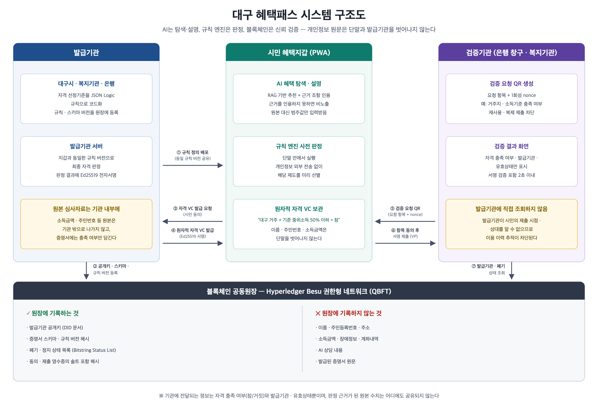
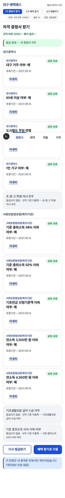
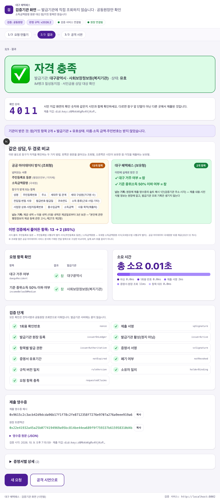

# 대구 혜택패스 (Daegu Benefit Pass)

> **"공공이 판정한 복지 자격을 은행 창구에서 소득 노출 없이 증명한다."**
> 2026 AI Blockchain Challenge in Daegu — 공모주제 ❺ 블록체인 기반 신뢰 인프라 · 팀 원비트

"무엇을 받을 수 있는지"는 국가의 복지멤버십(163종 안내)이 이미 알려줍니다. 남은 문제는 **공공이 확인해 준 자격을 민간 금융기관
창구에서 처음부터 다시 증명해야 한다**는 것입니다. 행정정보 공동이용은 행정기관 사이에서만 작동하므로, 연 11조 원 규모 정책서민금융을
취급하는 은행·저축은행 창구에서는 시민이 여전히 소득금액증명·수급자증명서 원문을 떼어 냅니다.

대구 혜택패스는 **대구시·복지기관(공공)이 판정한 자격**을 "기준 중위소득 50% 이하 = 참", "연소득 3,500만 원 이하 = 참"처럼
**사실 하나만 담은 검증가능 자격증명(VC)** 으로 발급하고, 시민은 은행이 제시한 QR 요청에 필요한 항목만 서명해 제출합니다.
은행은 공동원장에서 발급기관과 폐기 상태만 확인해 2초 안에 검증합니다. 소득 금액과 주민번호는 은행에 전달되지 않습니다.
AI 는 복지멤버십이 다루지 않는 **은행 서민금융(햇살론뱅크·새희망홀씨 등)과 민간 감면제도**를 근거 조항과 함께 안내하고, 창구에 어떤
증명서를 내면 되는지 알려줍니다.

| 역할 | 담당 | 하지 않는 것 |
|---|---|---|
| **공공 발급기관** (대구광역시 · 사회보장정보원 모사) | 자기 소관 사실만 규칙 엔진으로 판정해 원자적 VC 발급 | 원본 심사자료 외부 전송 |
| **은행·저축은행** (검증기관) | QR 요청 → 서명·원장 검증 → 참/거짓 항목만 수령. 신용평점은 자체 조회 | 발급기관 직접 조회, 원문 수집 |
| **AI** | 은행·민간 창구 혜택 탐색·설명·창구 제출 안내 (근거 조항 인용 필수) | 자격 판정 |
| **규칙 엔진** | 결정론적 적격 판정 (JSON Logic, TS/Python 동일 구현) | 개인정보 전송 |
| **전자서명 + 공동원장** | 발급기관 공개키·규칙 버전·폐기 상태·영수증 해시 | 개인정보 저장 |



## 5분 안에 실행하기

요구: macOS/Linux, Node ≥ 20, pnpm 12, Python ≥ 3.11, uv. (Docker 는 선택 — Besu 네트워크·격리 시연용)

```bash
make setup      # pnpm install + uv sync --all-packages
make build      # TS 패키지 빌드 + 컨트랙트 컴파일
make test       # Python + TS + 컨트랙트 테스트
make demo       # 체인 → 배포·시드 → 발급기관 2 → 검증기관 → AI → 지갑·검증기관 앱
make e2e        # (make demo 상태에서) Playwright 로 시연 ①~⑤ 자동 재현 + docs/screenshots 갱신
make smoke      # 헤드리스 통합: 체인 기동부터 발급·검증·폐기·공격·벤치·PII 스캔까지
make report     # docs/TEST_REPORT.md 재생성
```

`make demo` 후: 시민 지갑 http://localhost:3000 · 검증기관(은행 창구) http://localhost:3001 · 발급기관 API http://localhost:8001/docs (대구시) / 8003 (복지기관) · 검증 API 8002 · AI 8004.
AI 설명은 `ANTHROPIC_API_KEY` 가 있으면 Claude(`LLM_MODEL`, 기본 `claude-opus-5`), 없으면 템플릿 설명으로 자동 대체되어 **오프라인에서도 시연이 멈추지 않습니다**.

시연 순서(①~⑤)와 발표 멘트는 [docs/DEMO.md](docs/DEMO.md), 설계 결정은 [docs/DECISIONS.md](docs/DECISIONS.md), 구조 설명은 [docs/ARCHITECTURE.md](docs/ARCHITECTURE.md), 테스트 결과는 [docs/TEST_REPORT.md](docs/TEST_REPORT.md) 를 보세요.

## 저장소 구조

```
apps/wallet            시민 혜택지갑 PWA (Next.js) — 발급·AI 추천·제출·이력
apps/verifier          검증기관 화면 (Next.js) — 요청 QR·결과·공격 시연
services/issuer        발급기관 서버 (FastAPI) — ISSUER_ID=daegu|welfare (대구광역시 / 사회보장정보원 모사) 2개 인스턴스
services/verifier      검증 서비스 (FastAPI) — 은행·저축은행 창구, 용도 프리셋(햇살론뱅크·새희망홀씨…), 원장만 조회
services/ai            AI 추천·설명 (FastAPI + Anthropic SDK) — 범주값만 수신, 인용 검증, 템플릿 폴백
packages/rules         규칙 엔진 (ts/ + py/) + 규칙 번들 + 참조 구현 + 기댓값 270건
packages/vc            did:key · VC/VP(JWS EdDSA) · Bitstring Status List · JCS 해시 (ts/ + py/, 교차 검증)
packages/ledger-client 공동원장 클라이언트 (web3.py)
chain/                 Solidity 컨트랙트 4종 · Hardhat · 배포/시드 · PII 스캔 · Besu QBFT compose
data/                  기준 중위소득 2026(고시 확인) · 정책 13종(공공 복지 7 + 은행 서민금융 3 + 민간 감면 3) · 합성 시민 30명 · 기댓값
scripts/               시드 · 시연 · 벤치 · PII 지표 · 리포트
```

## 화면

| 시민 지갑 (PWA) | 검증기관 화면 |
|---|---|
|  |  |

전체 14장: [docs/screenshots/](docs/screenshots/) (Playwright E2E 가 자동 생성)

## 원장에 올라가는 것 / 올라가지 않는 것

| 기록 | 비기록 |
|---|---|
| 발급기관 공개키 (DID 문서) | 이름 · 주민등록번호 · 주소 |
| 규칙 번들·스키마 버전 해시 | 소득금액 · 장애정보 · 계좌내역 |
| 폐기·정지 상태 목록 (Bitstring Status List) | AI 상담 내용 |
| 동의·제출 영수증의 솔트 포함 해시 | 발급된 증명서 원문 |

`chain/scripts/scan-pii.ts` 가 체인의 모든 트랜잭션·이벤트를 훑어 위 항목이 없음을 확인합니다.

## 검증 기준 (제안요약서 검증 계획 대응)

| 항목 | 기준 | 구현 |
|---|---|---|
| 판정 정확성 | 합성 시민 30명 × 정책 13개 = 390건 100% 일치 | 참조 구현 기댓값 vs TS/Python 엔진 |
| 엔진 동등성 | TS/Python 번들 해시 동일 | `0x2032a0…dc15` 양쪽 일치 |
| 검증 성능 | p95 < 2초 | `scripts/bench_verify.py` |
| 개인정보 최소화 | 기관 전달 항목 70% 이상 감소 | 10개 → 2개 (80%), `scripts/pii_items.py` |
| 보안 | 위조·만료·폐기·재사용·타인 증명서·비활성 발급기관 차단 | `services/verifier/tests` + `/demo/attack` |
| AI 신뢰성 | 인용 없는 추천 비노출, 존재하지 않는 제도 차단, 페이로드 allowlist | `services/ai` 테스트 |
| 네트워크 격리 | 검증기관 → 발급기관 접속 불가 | `docker-compose.yml` (net-issuer 미포함) |

## 고지

- 시민 데이터는 **전원 가명·합성 데이터**입니다 (`data/citizens.json`). 실존 인물과 무관합니다.
- 발급기관(대구광역시·사회보장정보원)은 **모사**입니다. 실제 도입 시 모바일 신분증·행정정보·마이데이터 연계 어댑터(`IssuerDataSource`)로 교체되는 구조입니다. 은행은 발급기관이 아니라 검증기관이며, 신용평점은 창구가 자체 조회합니다.
- 제도 기준값은 보건복지부 고시(2026년 기준 중위소득 제2025-135호) 등 공개 자료를 따르되, 소득인정액을 월 소득으로 단순화했습니다 (`docs/DECISIONS.md` D-06).
- 키·계정은 로컬 데모용입니다. 실서비스에서는 HSM/KMS 와 다중서명 거버넌스로 교체합니다.

## 개발 환경 주의 (macOS · iCloud)

저장소가 iCloud Drive 동기화 폴더(바탕화면·문서) 안에 있으면 iCloud 가 파일에 hidden 플래그를 붙여 Python 3.12.10+ 가 `.venv` 의
editable `.pth` 를 건너뜁니다(`ModuleNotFoundError: dbp_*`). `make setup`·`make demo`·`make smoke` 는 `scripts/fix_venv.sh` 로 자동 보정하지만,
`uv run` 을 직접 쓸 때 오류가 나면 `./scripts/fix_venv.sh` 를 한 번 실행하세요. 저장소를 동기화 폴더 밖으로 옮기면 근본적으로 해결됩니다.

## 라이선스

MIT (제출용 프로토타입).
