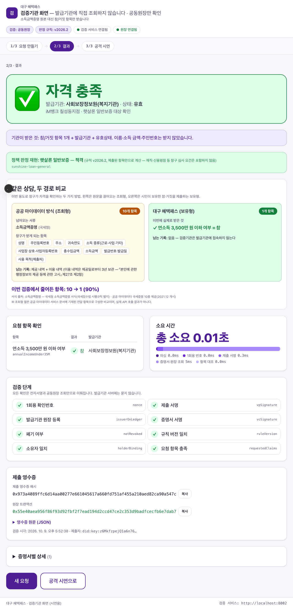
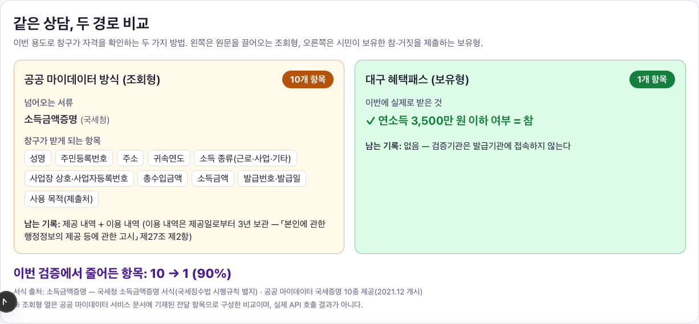

# 대구 혜택패스 (Daegu Benefit Pass)

> **"공공이 판정한 자격을 시민이 보유하고, 은행 창구에 충족 여부만 제출한다."**
> 2026 AI Blockchain Challenge in Daegu — 공모주제 ❺ 블록체인 기반 신뢰 인프라 · 팀 원비트

대구시·복지기관이 판정한 결과를 "연소득 3,500만 원 이하 = 참"처럼 사실 하나만 담은 검증가능 자격증명(VC)으로 발급하고,
시민이 창구가 요청한 항목만 골라 서명 제출하면 은행은 공동원장만 읽어 2초 안에 검증합니다.
**배경·문제 정의·차별성은 제안요약서를 보세요.** 이 문서는 실행 방법만 다룹니다.


## 5분 안에 실행하기

요구: macOS/Linux, Node ≥ 20, pnpm 12, Python ≥ 3.11, uv. (Docker 는 선택 — Besu 네트워크·격리 시연용)

```bash
make setup      # pnpm install + uv sync --all-packages
make build      # TS 패키지 빌드 + 컨트랙트 컴파일
make test       # Python + TS + 컨트랙트 테스트
make demo       # 체인 → 배포·시드 → 발급기관 2 → 검증기관 → AI → 지갑·검증기관 앱
make e2e        # (make demo 상태에서) Playwright 로 시연 ①~⑥ 자동 재현 + docs/screenshots 갱신
make smoke      # 헤드리스 통합: 체인 기동부터 발급·검증·폐기·공격·벤치·PII 스캔까지
make report     # docs/TEST_REPORT.md 재생성
make compose-isolation-up && make demo-isolation   # (Docker) 검증기관 컨테이너가 발급기관에 닿지 않음을 검사
```

`make demo` 후: 시민 지갑 http://localhost:3000 · 검증기관(은행 창구) http://localhost:3001 ·
발급기관 API http://localhost:8001/docs (대구시) / 8003 (복지기관) · 검증 API 8002 · AI 8004.

LLM 키는 **선택 항목**입니다. `ANTHROPIC_API_KEY` 가 있으면 Claude(`LLM_MODEL`, 기본 `claude-opus-5`)가 설명을 쓰고,
없으면 같은 화면이 템플릿 설명(`규칙 설명(템플릿)` 배지)으로 자동 대체되어 **오프라인에서도 시연이 멈추지 않습니다**.
자격 판정·검증은 어느 모드에서도 LLM 과 무관합니다.

## 문서

| 문서 | 내용 |
|---|---|
| [docs/DEMO.md](docs/DEMO.md) | 시연 순서 ①~⑦ 클릭 단위 스크립트와 발표 멘트 |
| [docs/ARCHITECTURE.md](docs/ARCHITECTURE.md) | 구조도 ①~⑦ 흐름과 코드 경로 매핑, 신뢰 경계, 원장 기록/비기록, 표준 대응 |
| [docs/TEST_REPORT.md](docs/TEST_REPORT.md) | 검증 기준별 측정 결과 (`make report` 로 자동 생성) |
| [docs/DECISIONS.md](docs/DECISIONS.md) | 설계 결정과 근거 |

## 저장소 구조

```
apps/wallet            시민 혜택지갑 PWA (Next.js) — 발급·AI 추천·제출·이력
apps/verifier          검증기관 화면 (Next.js) — 요청 QR·결과·비교 패널·공격 시연
services/issuer        발급기관 서버 (FastAPI) — ISSUER_ID=daegu|welfare (대구광역시 / 사회보장정보원 모사) 2개 인스턴스
services/verifier      검증 서비스 (FastAPI) — 은행·저축은행 창구, 창구 종류별 용도 프리셋 6종(햇살론 일반보증·새희망홀씨, 신용 하위 20% 고객용 포함), 원장만 조회
services/ai            AI 추천·설명 (FastAPI + Anthropic SDK) — 범주값만 수신, 인용 검증, 템플릿 폴백
packages/rules         규칙 엔진 (ts/ + py/) + 규칙 번들(daegu-eligibility@2026.2) + 참조 구현 + 기댓값
packages/vc            did:key · VC/VP(JWS EdDSA) · Bitstring Status List · JCS 해시 (ts/ + py/, 교차 검증)
packages/ledger-client 공동원장 클라이언트 (web3.py)
chain/                 Solidity 컨트랙트 4종 · Hardhat · 배포/시드 · PII 스캔 · Besu QBFT compose
data/                  기준 중위소득 2026(고시 확인) · 정책 13종(OR 분기별 증명 조합 requiredClaimSets) · 합성 시민 30명 · 기댓값 · comparison.json
scripts/               시드 · 시연 · 벤치 · PII 지표 · 격리 프로브 · 리포트
```

## 화면

| 시민 지갑 (PWA) | 검증기관 화면 | 같은 상담, 두 경로 비교 |
|---|---|---|
|  |  |  |

전체 21장: [docs/screenshots/](docs/screenshots/) (Playwright E2E 와 `make capture-isolation` 이 자동 생성)

## 고지

- 시민 데이터는 **전원 가명·합성 데이터**입니다 (`data/citizens.json`). 실존 인물과 무관합니다.
- 발급기관(대구광역시·사회보장정보원)은 **모사**입니다. 실제 도입 시 모바일 신분증·행정정보·마이데이터 연계 어댑터(`IssuerDataSource`)로 교체되는 구조입니다. 은행은 발급기관이 아니라 검증기관입니다. 신용평점은 VC 로 발급하지 않고 창구가 자체 조회합니다(규칙에는 `issuerOf: self` 항목 `creditBottom20` 으로 있고, 창구 조회값만 판정 재현에 들어감). 재직·보증 심사용 소득 증빙은 규칙에 넣지 않고 창구가 확인합니다.
- 제도 기준값은 보건복지부 고시(2026년 기준 중위소득 제2025-135호) 등 공개 자료를 따르되, 소득인정액을 월 소득으로 단순화했습니다 (`docs/DECISIONS.md` D-06). 기준 중위소득은 1~6인 고시값만 쓰며 7인 이상 가구는 6인 값으로 판정합니다(MVP 한계, D-22).
- 감면 정책 기준: 전기요금 복지할인·도시가스 경감은 수급자 또는 기준 중위소득 50% 이하(차상위), 이동통신요금 감면은 여기에 기초연금 수급 어르신 경로를 더합니다. 규칙은 이 경로를 65세 이상 + 기초연금 선정기준액 이하(월 소득 근사, D-06)로 판정하며, 실제 기초연금 수급 여부는 감면 신청 단계에서 확인됩니다. 장애인·유공자·대가족 등 혜택패스 claim 에 없는 감면 사유는 다루지 않습니다 (D-22).
- 검증 결과의 정책 판정 재현은 제출된 증명서와 창구가 직접 조회한 항목(신용평점)만으로 계산하고, 제출되지 않은 항목에 결과가 달려 있으면 적격을 단정하지 않고(`eligible: null`) 결과를 가르는 항목을 함께 돌려줍니다 (D-22).
- 서민금융 상품은 2026년 현행 기준입니다: 햇살론 일반보증(2026.1.2 개편 — 근로자햇살론·햇살론뱅크 통합, 은행·저축은행 등 전 금융업권 취급), 새희망홀씨Ⅱ(연소득 4,000만 원 이하 또는 신용평점 하위 20%이면서 5,000만 원 이하, 은행권 전용). 근거는 `data/policies/` 와 `docs/DECISIONS.md` D-21.
- 키·계정은 로컬 데모용입니다. 실서비스에서는 HSM/KMS 와 다중서명 거버넌스로 교체합니다.

## 개발 환경 주의 (macOS · iCloud)

저장소가 iCloud Drive 동기화 폴더(바탕화면·문서) 안에 있으면 iCloud 가 파일에 hidden 플래그를 붙여 Python 3.12.10+ 가 `.venv` 의
editable `.pth` 를 건너뜁니다(`ModuleNotFoundError: dbp_*`). `make setup`·`make demo`·`make smoke` 는 `scripts/fix_venv.sh` 로 자동 보정하지만,
`uv run` 을 직접 쓸 때 오류가 나면 `./scripts/fix_venv.sh` 를 한 번 실행하세요. 저장소를 동기화 폴더 밖으로 옮기면 근본적으로 해결됩니다.

## 라이선스

MIT (제출용 프로토타입).
